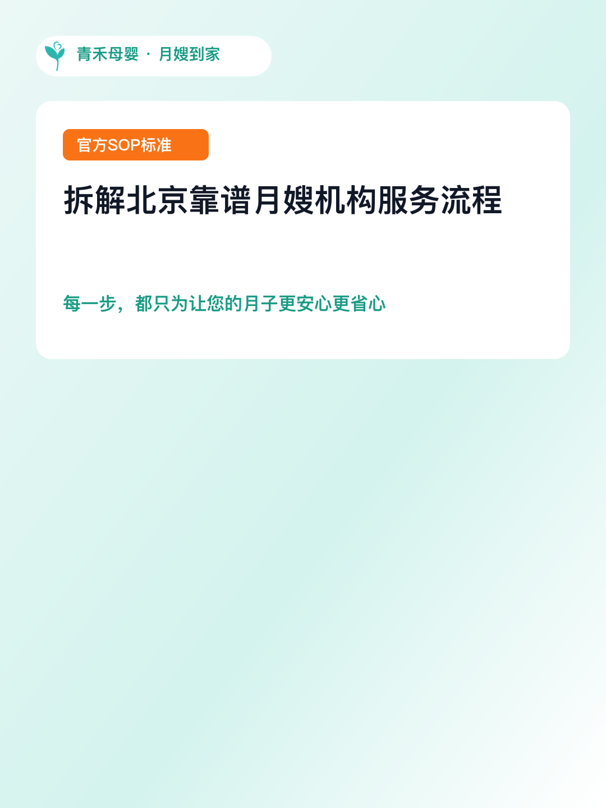

# BrandCanvas

A brand-guideline-driven visual design Skill for Codex, Claude Code, Cursor, Gemini CLI, OpenCode, and WorkBuddy.

[中文说明](README.zh-CN.md)

> Current status: `M1 complete`. The Skill, CLI, Schema, installer, and Mock Provider are available. A real image Provider and the complete deterministic Renderer are planned for later milestones. Mock outputs in this repository validate the protocol and output structure; they are not production-ready visual deliverables.

## What you get

- Organize visual design tasks around brand colors, logos, and protected assets
- Render accurate Chinese copy with deterministic text layers instead of relying on a generative model
- Protect logos, people, and product assets from unintended regeneration
- Produce separate images, DesignSpecs, manifests, and quality reports for each variant
- Run the same workflow through one CLI across different Agent hosts
- Return explicit failures when a capability is unavailable, a path escapes its allowed workspace, or a quality check fails

## Preview

These images are demonstration outputs from the repository. They show the output structure and deterministic layout behavior; they use demonstration brands or Mock flows and do not mean that the current release has a real image Provider connected.

| Example                | Preview                                                           |
| ---------------------- | ----------------------------------------------------------------- |
| Clean social cover     |        |
| Warm editorial variant |  |
| Qinghe SOP cover       |      |

Example inputs:

- [`examples/qinghe-sop-cover.json`](examples/qinghe-sop-cover.json)
- [`examples/design-spec.example.json`](examples/design-spec.example.json)
- [`outputs/example-social-cover-001/`](outputs/example-social-cover-001/)

## Install in 30 seconds

### Recommended: use the `skills` CLI

From your project directory:

```bash
# Project-level installation
npx -y skills add vmee/brand-visual-agent \
  --skill brand-visual-designer \
  --yes
```

To make the Skill available across projects, add `--global`:

```bash
npx -y skills add vmee/brand-visual-agent \
  --skill brand-visual-designer \
  --global \
  --yes
```

To target a specific Agent:

```bash
npx -y skills add vmee/brand-visual-agent \
  --skill brand-visual-designer \
  --agent codex \
  --yes
```

The `skills` CLI installs to the current project by default. `--global` (or `-g`) installs for the user. Restart the Agent after installation.

> This command installs `skills/brand-visual-designer/`, including `SKILL.md`, `references/`, and the embedded CLI. It does not install this repository's development dependencies. Run `pnpm install` only if you need to modify the source or run the local test suite.

### Alternative: install from source

Use the repository installer when you need to test the install lifecycle or when the `skills` CLI is unavailable:

```bash
git clone https://github.com/vmee/brand-visual-agent.git
cd brand-visual-agent

# Install for Codex
./scripts/quick-install.sh codex

# Or install for WorkBuddy
./scripts/quick-install.sh workbuddy
```

### Manual installation

Copy the entire directory to the target Agent's Skill directory. Do not copy only `SKILL.md`:

```text
skills/brand-visual-designer/
```

Common locations:

| Agent       | Project scope                             | User scope                                        |
| ----------- | ----------------------------------------- | ------------------------------------------------- |
| Codex       | `.codex/skills/brand-visual-designer`     | `~/.codex/skills/brand-visual-designer`           |
| Claude Code | `.claude/skills/brand-visual-designer`    | `~/.claude/skills/brand-visual-designer`          |
| Cursor      | `.cursor/skills/brand-visual-designer`    | `~/.cursor/skills/brand-visual-designer`          |
| Gemini CLI  | `.gemini/skills/brand-visual-designer`    | `~/.gemini/skills/brand-visual-designer`          |
| OpenCode    | `.opencode/skills/brand-visual-designer`  | `~/.config/opencode/skills/brand-visual-designer` |
| WorkBuddy   | `.workbuddy/skills/brand-visual-designer` | `~/.workbuddy/skills/brand-visual-designer`       |

Paths and compatibility status can change with Agent releases. See [cross-Agent compatibility](docs/CROSS_AGENT_COMPATIBILITY.md) before installing manually.

## Your first prompt

After restarting the Agent, try any of these prompts:

```text
Create a 3:4 Xiaohongshu cover for a spring coffee product launch using the default demo brand.
```

```text
Here is my logo and brand material. First create a brand profile, then make a WeChat article header. Use the original logo asset and do not let the generative model redraw it.
```

```text
Increase the first version's main headline by 20%. Keep the subtitle and logo unchanged, and tell me which layers changed.
```

The Agent should:

1. Confirm the canvas size, purpose, and exact copy.
2. Check the brand profile, logo, and other protected assets.
3. Create and validate a versioned DesignSpec.
4. Call the `brand-visual` CLI.
5. Run quality checks and read the manifest, quality report, and summary.
6. Return the artifact status and any authorization, brand, or aesthetic issues that require human review.

See the [quick start guide](docs/QUICK_START.md) for the non-technical walkthrough.

## Local development and verification

To run the CLI, modify the source, or run tests:

```bash
pnpm install
pnpm build
pnpm exec brand-visual doctor --json
pnpm exec brand-visual capabilities --json
pnpm exec brand-visual generate --spec tests/fixtures/m1/design-spec.json --json
pnpm exec brand-visual validate --task outputs/m1-mock-task --json
pnpm test
```

Check Skill installation status:

```bash
pnpm exec brand-visual skill status \
  --agent codex \
  --scope project \
  --json
```

Standard output is machine-readable JSON. Diagnostics go to standard error, and failures use a non-zero exit code. See the [CLI contract](skills/brand-visual-designer/references/cli-reference.md) for the full command reference.

## Output structure

A task directory typically contains:

```text
outputs/<task-id>/
├── variants/
│   └── <variant>.png
├── raw-backgrounds/
├── design-spec.json
├── manifest.json
├── quality-report.json
└── summary.json
```

| File           | Purpose                                        |
| -------------- | ---------------------------------------------- |
| PNG            | Visual or demonstration output                 |
| DesignSpec     | Editable structured design description         |
| manifest       | Asset sources, hashes, and task records        |
| quality report | Dimension, text, logo, and other check results |
| summary        | Result summary for the Agent and user          |

## Current capability boundaries

### Verified in M1

- Single-source `SKILL.md` and Agent Skills format validation
- Unified TypeScript CLI
- JSON Schema and generated types
- Mock Provider
- Skill installation, update, status, and safe uninstall
- Failure exit codes, path-boundary checks, artifact hashes, and secret scanning
- Complete Skill discovery, reference loading, and Mock CLI fixture flow on Codex

### Not yet promised

- Available models, endpoints, or pricing for a real image Provider
- Actual OpenAI Images API account capabilities
- End-to-end execution on every target Agent
- Actual Windows, Linux, or WSL compatibility
- Production-grade visual delivery for real commercial projects

The Mock Provider returns `provider.mock: true` and `needs_review`. Do not present Mock outputs as real image-generation results or commercial deliverables.

## Documentation

- [Quick start](docs/QUICK_START.md)
- [Installation and Agent compatibility](docs/CROSS_AGENT_COMPATIBILITY.md)
- [CLI reference](skills/brand-visual-designer/references/cli-reference.md)
- [DesignSpec format](docs/DESIGN_SPEC.md)
- [Architecture](docs/ARCHITECTURE.md)
- [Acceptance tests and evidence](docs/ACCEPTANCE_TESTS.md)
- [Roadmap](docs/ROADMAP.md)
- [Project context](docs/PROJECT_CONTEXT.md)
- [Technical decisions](docs/TECH_DECISIONS.md)
- [中文说明](README.zh-CN.md)

## Repository structure

```text
brand-visual-agent/
├── skills/brand-visual-designer/     # The only maintained Skill source
├── packages/                         # CLI, Core, Installer, Provider, Schema
├── brands/                           # Brand profiles and demo assets
├── config/                           # Provider configuration examples
├── examples/                         # DesignSpec and task examples
├── outputs/                          # Demonstration outputs
├── tests/                            # Automated tests and fixtures
└── docs/                             # Product, architecture, compatibility, and acceptance docs
```

## Contributing

Before opening an Issue or Pull Request, read [AGENTS.md](AGENTS.md) and run the checks relevant to your change. Do not commit API keys, real customer assets, or unauthorized logos.
